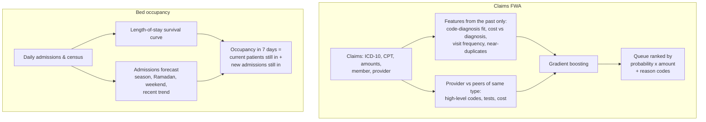

# 🏥 UAE Health Insurance & Hospital Analytics

**Two problems every UAE payer and hospital group faces: stop money leaking through fraudulent and wasteful
claims, and know a week ahead when the wards will be full.**

> Data: simulated UAE health insurance claims (12,000 members, 120 providers in Dubai, Abu Dhabi and Sharjah,
> ICD-10 diagnoses and CPT-style procedure codes) with five planted fraud, waste and abuse schemes and realistic
> legitimate look-alikes; and simulated inpatient flows for four hospitals with UAE seasonality (winter peak,
> summer travel dip, Ramadan, Saturday-Sunday weekend, flu surges). No real patient or provider data is used.

---

## 1. Claims fraud, waste and abuse (FWA)

Schemes detected: **upcoding** (high-level consultations for simple diagnoses), **unbundling** (a delivery package
billed as separate parts), **excessive tests**, **phantom visits** and **duplicate submissions**.

**Results** (trained Jan to Aug 2025, tested Sep to Dec 2025 on 13,106 claims, AED 1.24M at risk; the
investigations team can review 5% of claims)

| Review queue ordered by | Precision | AED caught | Share of FWA money | Net saving after review cost |
|---|---|---|---|---|
| Claim edits (rules in use at most payers) | 59.5% | AED 604K | 48.7% | AED 506K |
| **ML model + provider peer comparison, ranked by AED at risk** | **85.8%** | **AED 1.09M** | **87.6%** | **AED 988K** |
| ML model ranked by probability only | 97.9% | AED 789K | 63.6% | AED 690K |

**Nearly double the net saving of rules from the same review effort.** Ranking by *expected money at risk*
(probability × amount) instead of probability alone catches 24 points more of the money: it sends reviewers to the
expensive suspicious claims first. Within capacity the queue catches 99% of upcoding, 98% of excessive testing and
100% of unbundled packages; phantom visits and duplicates are smaller claims and are partly left for the next review cycle.

Every claim in the queue carries reasons an auditor can verify, for example
*"Lab tests far beyond what the diagnosis needs; Provider orders far more tests than peers"* or
*"Same service code billed more than once"*.

## 2. Bed occupancy forecast, 7 days ahead

| Method (2025, 4 hospitals) | Mean error | Mean % error |
|---|---|---|
| **Admissions model + length-of-stay curve** | **17.8 beds** | **7.1%** |
| Same as today | 20.1 beds | 8.4% |
| Average of the last 4 weeks | 20.7 beds | 8.6% |

Bed managers get a high-occupancy alert a week ahead (56% of over-92% days caught, 68% of alerts correct), time to
move elective admissions, open surge beds or arrange step-down care.

---

## How it works



| Component | Where |
|---|---|
| Claims simulator with FWA schemes | `src/healthins/claims.py` |
| FWA features, peer comparison, rules, model, reason codes | `src/healthins/fwa.py` |
| Hospital flows, length-of-stay curve, occupancy forecast | `src/healthins/beds.py` |
| End-to-end evaluation | `src/healthins/pipeline.py` |
| Investigator and bed-manager dashboard | `dashboard.py` |

## Quick start

```bash
git clone https://github.com/vineethasusan/uae-health-insurance-analytics.git
cd uae-health-insurance-analytics
python -m venv .venv && source .venv/bin/activate
make install
make pipeline     # ~1 minute -> outputs/report.md, fwa_review_queue.csv
make dashboard    # http://localhost:8501
```

## Design decisions

- **Rank by money, not just probability.** Review capacity is the constraint; a 9,000-dirham suspicious delivery
  claim deserves attention before a 60-dirham one.
- **Compare providers with their peers.** Schemes are run by providers, so a clinic that bills high-level
  consultations three times as often as similar clinics is a stronger signal than any single claim.
- **No look-ahead.** Visit counts and duplicate checks only look backwards in time; provider peer statistics are
  computed on the training period only.
- **Explainable.** Regulators (DHA, DoH) and providers will ask why a claim was held; every flag has plain-language reasons.
- **Forecast the flows, not just the total.** Occupancy is built from admissions and length of stay, so the model
  reacts to a surge in admissions days before the wards fill up.

## Roadmap

- Network analysis of member-provider links to find organised phantom-billing rings
- Pre-authorisation scoring at the point of request, before money is paid
- Discharge-date prediction per patient to sharpen the bed forecast
- LLM summaries of each case for investigators, from the claim facts

## Author

**Vineetha Susan Alexander** · Senior Data Scientist & AI Consultant, Dubai
[LinkedIn](https://www.linkedin.com/in/vineetha-susan-alexander-465997135) · [GitHub](https://github.com/vineethasusan)

MIT License.
